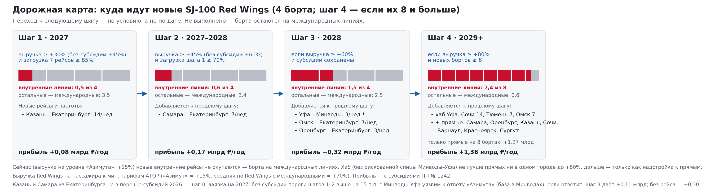
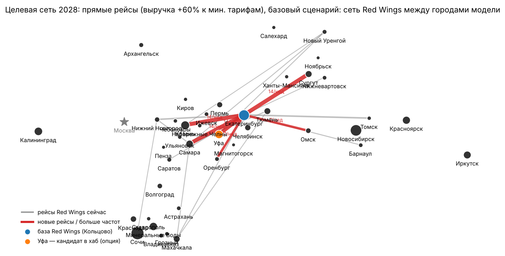

# Red Wings: новый хаб или прямые рейсы — куда направить новые SJ-100

Команда **«Пухососы»** · кейс-чемпионат «Моделирование связанности территорий на базе ИИ», трек Red Wings.
Паспорт проекта — [`docs/passport_short.md`](docs/passport_short.md) (подробно — [`docs/passport_final.md`](docs/passport_final.md)) · все цифры — [`docs/results_for_passport.md`](docs/results_for_passport.md)

**Интерактивный калькулятор сети:** https://andreyv105105105.github.io/Puhososy/calculator.html — двигайте выручку Red Wings на пассажира, стоимость блок-часа и субсидии и смотрите, какую сеть строит модель (файл — [`docs/calculator.html`](docs/calculator.html), открывается и локально в браузере).

## Главный вывод
_Ветка `feature/model-tariff` — версия 2 модели: тариф рейсов короче 550 км приведён к реальным ценам, добавлена проверка ответа конкурентов. Сданная версия 1 — в ветке `main`._

- **Сейчас** (выручка Red Wings на пассажира на уровне «Азимута», +15% к минимальным тарифам АТОР) новые SJ-100 на внутренних линиях **не окупаются ни в одном варианте** — их место на международных линиях.
- **Основа роста — прямые рейсы из Екатеринбурга.** При выручке +30% — Казань–Екатеринбург до 14 рейсов в неделю (0,5 борта, +0,08 млрд ₽); при +45% — ещё Самара–Екатеринбург до 7 (+0,17 млрд ₽); при +60% — 1,5 борта, +0,32 млрд ₽, +118 тыс. пассажиров: добавляются Омск и Оренбург.
- **Новый хаб не открывается.** Самара (наша исходная гипотеза) не окупается ни при каких условиях. После сверки тарифа коротких рейсов с реальными ценами не окупаются и остальные: до выручки +60% хаб не открывается ни в одном проверенном городе, при +60% Казань даёт +0,22 млрд ₽ (стыкуется 15% пассажиров), Уфа — около нуля.
- **«№2 в своём сегменте»** (рейсы в обход Москвы между 40 городами, по креслам): Red Wings сейчас 8-я (3,9%), целевая сеть 2028 — 6-я (5,2%); до №2 (Utair, 16,9%) — ещё ≈ 12 бортов (`python model/segment_share.py`).
- **Порог роста закрывается сервисами, а не тарифом:** +30% к минимальным тарифам ≈ +1,5 тыс. ₽ с пассажира, +45% ≈ +3 тыс. ₽ — масштаб допуслуг и продажи стыковок через Кольцово. Аудит сайта и приложения и предложения — в паспорте и `research/strategy_no2_digital.md`.
- Вывод проверен порогами, 28 проверками допущений, Монте-Карло, фактическими закрытиями аэропортов и тремя реальными неудачными запусками коротких рейсов (по ним откалибрована поправка на спрос новых пар).





## Как запустить
```bash
pip install -r requirements.txt
python model/run_full.py                # полный пересчёт одной командой: пороги, хабы, проверки, карты, отчёт (около 4 минут)
python model/run_all.py                 # весь расчёт: спрос → выбор → сценарии → устойчивость → карты → сводка
python model/step7_thresholds.py all    # пороги окупаемости (дольше: перебор условий)
python model/step7_hub_city.py          # хаб в пяти городах-кандидатах
python model/step7_target_network.py    # целевая сеть 2028 и пороги без субсидий
python model/step8_roadmap.py           # картинка дорожной карты по порогам → results/roadmap.png
python model/step10_calculator_grid.py 2 && python model/step11_build_calculator.py   # калькулятор (≈ 1,5 ч на 2 ядрах)
```
Python 3.10+, пакеты: pandas, numpy, matplotlib (airportsdata — только для ранних скриптов). Все допущения — в одном файле [`model/params.py`](model/params.py), у каждого указан источник или пометка «допущение».

## Как устроена модель
| Шаг | Файл | Что делает |
|---|---|---|
| 1. Спрос | `model/step1_demand.py` | гравитационная модель T = k·(Mi·Mj)^a / d^θ, МНК по 179 парам с фактическими рейсами всех перевозчиков; проверка на отложенных парах |
| 2. Выбор пассажира | `model/step2_choice.py` | логит-модель: прямой рейс каждого перевозчика, через Москву, через Екатеринбург/новый хаб, соседний аэропорт (до 250 км по дороге), поезд (РЖД), машина |
| 3. Сценарии | `model/step3_scenarios.py` | хаб / прямые / гибрид при одинаковом флоте; жадный алгоритм по прибыли на блок-час; перегоны, база хаба, субсидии, фактические закрытия аэропорта; спрос пар без рейсов ×0,3 |
| 6. Устойчивость | `model/step6_sensitivity.py` | 28 проверок по одному допущению + Монте-Карло 500 прогонов (сети при выручке +45%) |
| 7. Пороги | `model/step7_*.py` | при какой выручке / стоимости часа сеть растёт; выбор города хаба (с долей стыковочных); целевая сеть 2028 |
| 8–9. Отчёт | `model/step8_map.py`, `model/step9_report.py` | карты сети и сводка для паспорта |

Проверки: `model/check_features.py` (туризм, федеральный округ, нелинейность — не улучшают модель), `python model/step7_hub_city.py utair` (хаб в Уфе без маршрутов Utair → `results/hub_ufa_without_utair.csv`). Ранние скрипты: `model/city_rating.py` (рейтинг 15 городов — отбор 5 кандидатов), `model/time_savings.py`, `model/svx_hub_fleet.py`.

## Данные (`data/`)
| Файл | Что внутри | Источник |
|---|---|---|
| `airports.csv` | 40 аэропортов: координаты, пассажиропоток 2024–2025, население | сайты аэропортов, avia-adv.ru, Интерфакс, Росстат 01.01.2025 |
| `boards_week.csv` | табло вылета 16 аэропортов, все перевозчики, рейсов в неделю | Яндекс Расписания, неделя 10–16.11.2026 |
| `boards_new_cities.csv`, `raw_boards_new_2026-11-10.csv` | табло 24 новых аэропортов (вторник × 7 — оценка недели) и сырые рейсы со ссылками | Яндекс Расписания, 10.11.2026 |
| `routes.csv` | маршруты Red Wings с частотами и ссылкой на каждый | Яндекс Расписания, 06.11.2026 |
| `fares_ator_2026-08-03.csv` | минимальные тарифы, 24 пары | АТОР |
| `rail.csv`, `rail_daily_checks.csv` | поезда: время, частота, цена купе, 9 пар | РЖД, 08.11.2026 |
| `load_factors.csv` | загрузка кресел по авиакомпаниям | отчёты авиакомпаний, Минтранс |
| `seasonality.csv` | доля ноября в годовом потоке | аэропорт Красноярск |

Проверка допущений по первоисточникам — `research/`: базы Red Wings, стоимость базы в Самаре, выручка на пассажира и структура затрат (РСБУ), поезда, субсидируемые маршруты 2026, история коротких рейсов 2021–2023, сеть Utair из Уфы.

## Результаты (`results/`)
`scenarios_summary.csv` — сравнение гипотез · `thresholds_*.csv` — пороги (в т.ч. без субсидий) · `hub_city_compare.csv` — выбор города хаба (прибыль, доля стыковочных) · `target_network_2028.csv` — целевая сеть · `routes_table.csv` — маршрут · пассажиров в год · рейсов в неделю · источник · `sensitivity.csv`, `monte_carlo.csv` — устойчивость · `demand_*.csv`, `choice_*.csv` — калибровка · `map_*.png` — карты. `results_14/` — ранняя версия на 16 крупных аэропортах (до исправлений 10.11, для истории).

## Как использовали ИИ
Gemini Deep Research — 5 исследований; Claude — сбор данных в таблицы, код модели, черновики. Каждая цифра сверена с первоисточником; найденные ошибки ИИ (частоты рейсов, размер хаба, стоимость блок-часа, выдуманные ссылки и др.) задокументированы. Промты, отчёты и таблицы проверки — папка [«Материалы ИИ»](Материалы%20ИИ/).

## Ограничения
Потоки «откуда–куда» в открытом доступе отсутствуют — спрос по парам является оценкой модели (корреляция с фактом 0,51, половина рейсов — в пределах ±2 раз). На парах без рейсов модель завышает спрос — поправка ×0,3 откалибрована на трёх реальных запусках, проверены ×0,5 и ×1,0. Поэтому выводы сделаны по сравнению вариантов и порогам, а не по точному числу пассажиров. Выручка и стоимость часа — оценки по РСБУ; тариф — минимум АТОР августа; на парах короче 550 км — 0,6 от формулы по сверке с 55 реальными ценами (`research/fares_real_2026-11.md`), границы 0,5 и 0,7 — `python model/check_short_fare.py`; +45% к минимальным тарифам (≈ +3 тыс. ₽ с пассажира) — требовательное условие; ответ конкурентов не моделируется, а проверен тремя сценариями (`python model/check_competitor.py`). По аэропортам в сумме модель точнее, чем по парам: R² 0,88, ранговая корреляция 0,96. С данными бронирований и калькуляцией Red Wings модель пересчитывается одной командой.

## Ошибка, которую мы нашли сами
10.11 на стресс-тесте выяснилось, что расстояние до соседнего аэропорта считалось по прямой: модель «возила» пассажиров из Сочи в Ставрополь через горы, и хаб в Волгограде получал ложный плюс. Исправили (по дороге, не дальше 250 км; Сочи — с крюком ×1,6), добавили поправку на спрос новых пар и фактические закрытия аэропортов, пересчитали всё. Главный вывод («прямые из Екатеринбурга, хаб в Самаре не окупается») не изменился, поменялись цифры и лучший кандидат в хаб.
